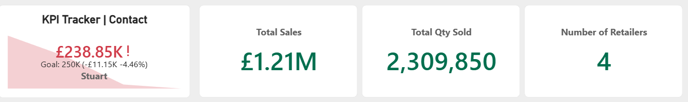
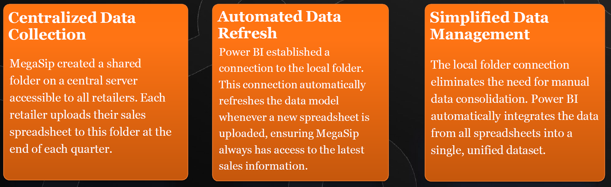
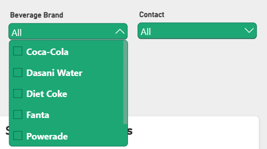
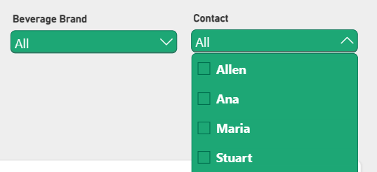
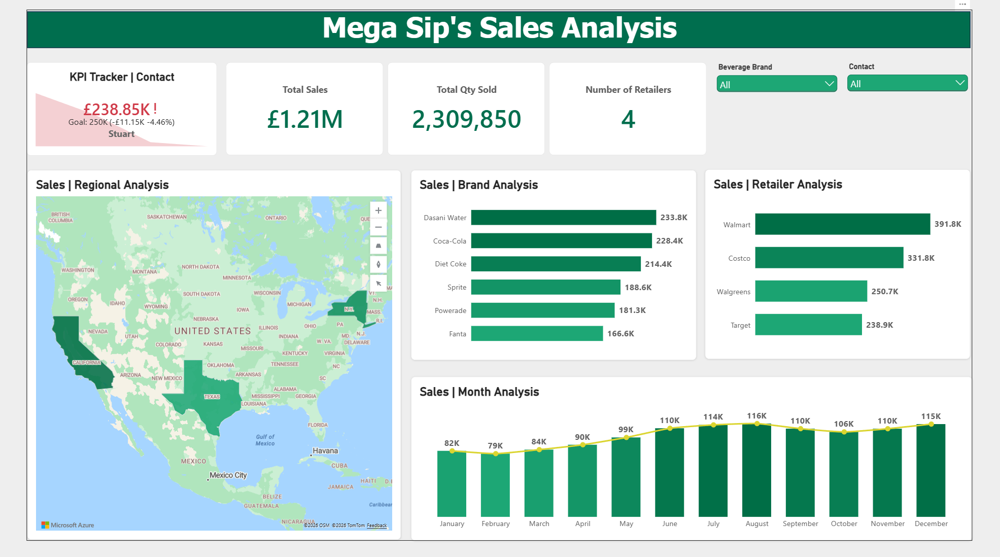

# Overview

Mega Sip Beverages is a growing beverage distribution company supplying popular brands such as Coke, Fanta, Sprite, and other leading soft drinks to major retailers including Costco, Walgreens, Target, and Walmart. As the organisation expanded, sales reporting became increasingly fragmented due to reliance on separate spreadsheets managed by regional managers. To address challenges related to data consolidation, reporting accuracy, and analytical capability, MegaSip implemented a Power BI solution using a centralised folder connection and automated refresh, enabling real-time visibility of performance across all locations.

## Problem Statement

The use of independently maintained spreadsheets created a siloed reporting environment that lacked consistency, efficiency, and analytical depth. Consolidating multiple spreadsheets into a unified report required manual intervention, making the process slow, error-prone, and dependent on inconsistent data entry practices. The limitations of spreadsheet-based reporting prevented the business from conducting robust trend analysis, geographic performance tracking, and retailer comparison, restricting the organisation’s ability to make timely and strategic decisions

## Aim

The objective of the project was to modernise MegaSip’s reporting infrastructure by replacing manual spreadsheet-based reporting with an automated, scalable, and interactive analytics environment. The project aimed to integrate sales data from all regional managers into a centralised system using Power BI folder connections, improve data consistency and accuracy, and provide an analytical platform capable of delivering actionable insights on sales trends, retailer performance, and product-level contribution.

## Datasource

The dataset used in this project was a simulated company dataset structured around a retail sector scenario. It reflects real-world data patterns and problem.

The data was cleaned and modeled into a star schema, ensuring it's optimized for performance and scalability in Power BI.

> [!WARNING]
> Note: This dataset is fictional and intended for portfolio purposes only. No real customer data is used.

## Using Power Bi for Folder Connections

## Analytical Approach
The dashboard is structured around key performance indicators (KPIs), providing a comprehensive view of sales performance against targets, total revenue, quantity sold, and retailer coverage.
It enables analysis of monthly sales trends, regional performance, beverage brand contributions, and retailer performance to support data-driven decisions and strategic business growth.

**Key Metrics**

- Sales Target: **£250,000**
- Total Sales: **£1,213,018**
- Total Quantity Sold: **2,309,850**
- Number of Retailers: **4**

**Analysis Performed**
- How are we performing against our 250K sales target?
- What are our total sales and units sold?
- Which brands generate the most sales?
- Which retailers contribute the most?
- Which states perform best?
- How have sales changed over the year, and when are the peaks and dips?

## Slicer by Brand

## Slicer by Contact

**Key Insights**

- Mega Sip’s generated £1.21M in sales from 2,309,850 units across four retailers, but Stuart sits at £238.85K against a £250K goal, a shortfall of £11.15K (-4.46%). 

- Brand performance is fairly even, led by Dasani Water (233.8K), Coca-Cola (228.4K), and Diet Coke (214.4K), with Fanta lowest at 166.6K.

- Revenue depends heavily on a few accounts and states. Walmart (391.8K) and Costco (331.8K) make up about 60% of retailer sales, and California, Texas, and New York dominate regionally. 

- Sales are seasonal, lowest in February (79K), peaking in August (116K), dipping from September to November, and recovering to 115K in December. 

**Recommendation**

- Close the target gap with monthly milestones.
- Reduce dependency on Walmart and Costco.
- Plan promotions and stock around seasonality.

